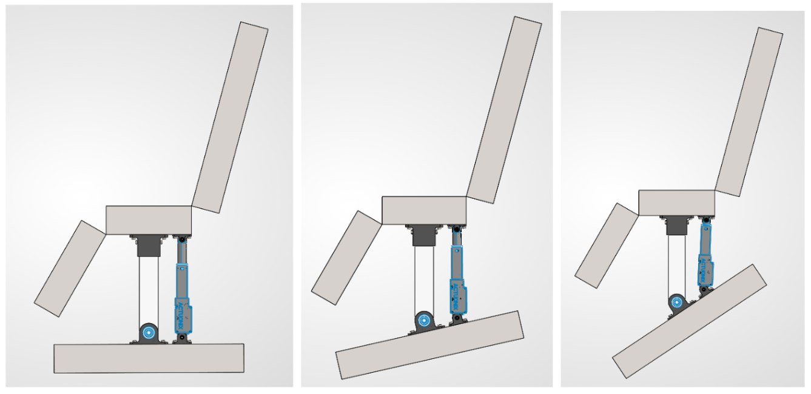
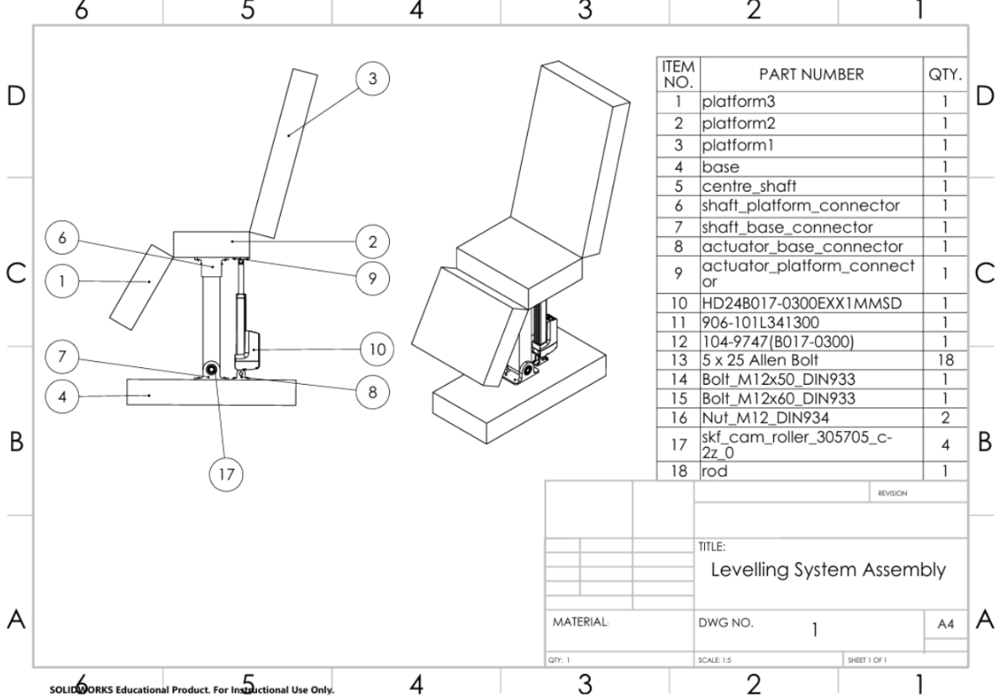
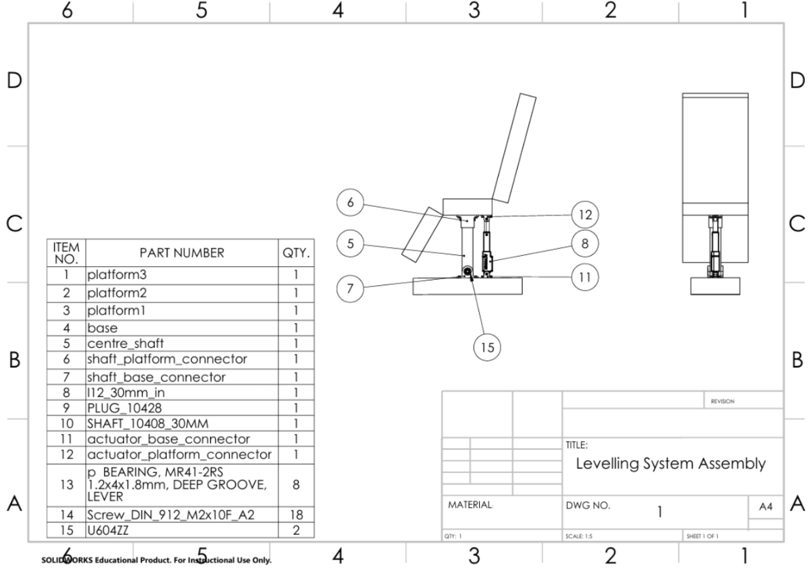
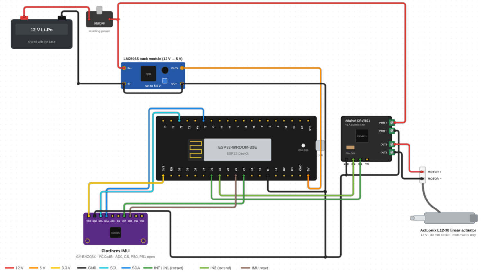
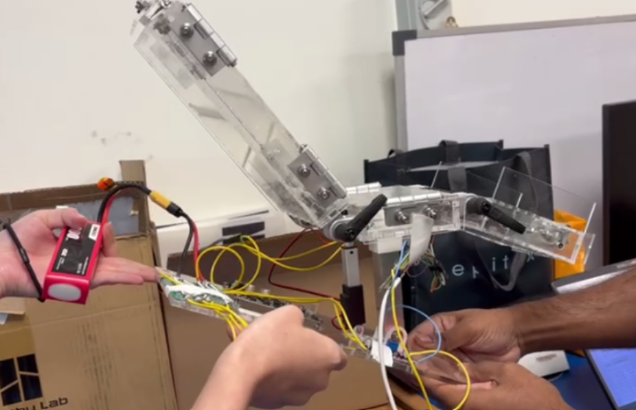
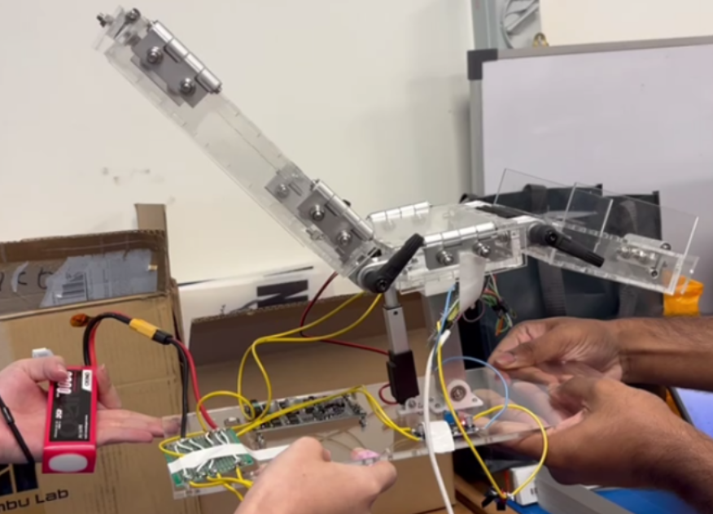
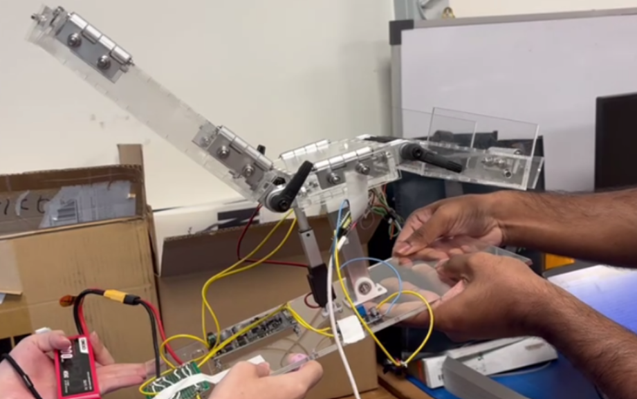

# RB4107 Levelling System

Automatic pitch-levelling system for the RB4107 Aircraft Emergency Stair Evacuation Robot, developed as part of the National University of Singapore (NUS) Robotics System Design Project.

The levelling system is mounted between the tracked base and the casualty platform. Its purpose is to maintain the casualty platform in a near-horizontal position while the robot traverses aircraft emergency airstairs. As the base inclines along the stairs, a linear actuator adjusts the platform angle in the opposite direction to compensate for the change in pitch.

The system uses an ESP32 microcontroller, two BNO085 IMUs and a feedback-controlled linear actuator to achieve automatic pitch compensation.

## Repository Layout

```text
Levelling-System/
├── Actual Model/                  Full-scale CAD model
├── Prototype Model/               1:5-scale prototype CAD model
├── levelling_auto/                 ESP32 firmware
├── m2-metric-socket-cap-head-screws-1.snapshot.7/
│                                    Metric socket cap head screws
├── u604zz-1.snapshot.1/             U604ZZ bearing CAD model
├── u604zz-deep-groove-1.snapshot.1/
│                                    Deep-groove bearing CAD model
├── LICENSE
└── README.md
```

### CAD Models

Two CAD versions are included:

- **Actual Model:** Full-scale design intended to meet the mechanical and actuator requirements of the evacuation system.
- **Prototype Model:** 1:5-scale design used for fabrication, assembly and functional testing.

The CAD models include the platform pivot, supporting pole, actuator mounting arrangement, hinges and associated mechanical components.

## System Overview

The levelling system consists of a pivoting casualty platform supported by a central pole and controlled by a linear actuator.

The pole connects the platform to the tracked base through a rotational joint. The actuator is mounted between the base and the platform, allowing it to extend or retract to change the platform angle.

When the robot travels down the stairs, the base pitches forwards. The levelling system detects this change and adjusts the actuator to rotate the platform in the opposite direction.

Only pitch compensation is implemented. Roll correction is not required for the current design because the robot travels along a relatively straight stair flight.



### Levelling Requirements

| Parameter | Requirement |
|---|---|
| Stair inclination | Up to 35° |
| Levelling range | ±40° |
| Platform accuracy | Within ±1° in steady state |
| Maximum casualty load | 120 kg |
| Casualty configuration | Seated and lying |
| Power loss | Mechanism holds its last position |
| Control | Automatic pitch compensation |

## Mechanical Design

### 1. Pivot Mechanism

The platform rotates about a central pivot pole positioned near the seat centre.

The pole is fixed to the casualty platform and connected to the base through a rotational joint. This arrangement allows the platform and pole to rotate together as a rigid assembly.

The pivot position was selected to balance the actuator holding force and mechanical packaging requirements.

Moving the pivot towards the backrest hinge would reduce the required holding moment. However, this would interfere with the folding backrest mechanism. The seat-centre pivot was therefore selected to preserve the required backrest movement.

### 2. Linear Actuator

A linear actuator connects the tracked base to the casualty platform.

By extending or retracting, the actuator produces a rotational moment about the central pivot, allowing the platform to compensate for changes in base inclination.

The actuator is positioned 225 mm behind the pivot on the prototype design.

The full-scale design requires an actuator with approximately:

| Parameter | Specification |
|---|---|
| Required force | At least 10 kN |
| Required stroke | Approximately 288 mm |
| Required tilt range | ±40° |
| Proposed actuator | Thomson Electrak HD24-B100 |

For the 1:5 prototype, an Actuonix L12-30-100-12-P linear actuator is used to demonstrate the levelling mechanism over a reduced angular range.

### 3. CAD Design

The repository contains both the full-scale and prototype CAD assemblies.

The full-scale model is designed around the required casualty load and stair inclination. The prototype model retains the same general mechanism and joint arrangement while using smaller components suitable for fabrication and testing.

A CAD motion study was conducted to examine the mechanism throughout the required base inclination range. The study demonstrates how the platform remains level while the base changes orientation and the actuator extends or retracts.





## Electronics and Hardware

### Hardware Components

| Component | Function |
|---|---|
| ESP32 DevKit (ESP32-WROOM-32E) | Main controller |
| 2 × BNO085 IMU | Base and platform orientation measurement |
| Actuonix L12-30-100-12-P | Prototype linear actuator |
| Adafruit DRV8871 | Bidirectional actuator motor driver |
| Linear actuator potentiometer | Actuator position feedback |
| LM2596S buck converter | Steps 12 V down to 5 V |
| 12 V Li-Po battery | Power supply |

### 1. Controller

The ESP32 processes orientation measurements from the IMUs and controls the linear actuator accordingly.

It also handles actuator calibration, position feedback, safety conditions and wireless telemetry.

### 2. Inertial Measurement Units

Two BNO085 IMUs are used to measure the orientation of the system.

- **Base IMU:** Measures the inclination of the tracked base.
- **Platform IMU:** Measures the actual orientation of the casualty platform.

Both sensors communicate with the ESP32 through I²C.

The BNO085 performs sensor fusion internally and provides orientation data through its Game Rotation Vector report. The ESP32 extracts the pitch angle from the reported quaternion.

The two IMUs share the same I²C bus but use different addresses:

| IMU | I²C Address |
|---|---|
| Base IMU | 0x4B |
| Platform IMU | 0x4A |

### 3. Motor Driver

The Adafruit DRV8871 H-bridge controls the direction and speed of the linear actuator.

The ESP32 generates the required control signals, allowing the actuator to extend, retract or stop.

### 4. Power Distribution

The prototype uses a 12 V Li-Po battery as its main power source.

The power distribution is as follows:

- 12 V supplies the linear actuator motor driver.
- The LM2596S buck converter reduces the supply voltage to 5 V for the ESP32.
- The IMUs and other low-voltage electronics are powered through the ESP32's regulated supply.

All electronic components share a common ground.



## Firmware

The ESP32 firmware is located in:

```text
levelling_auto/
```

The firmware implements automatic pitch compensation using IMU measurements and linear actuator position feedback.

### 1. Control Approach

The controller uses feedback from the platform IMU to maintain the casualty platform at its predefined reference angle.

The control system consists of:

- IMU orientation measurement.
- Reference-angle comparison.
- PI control for levelling correction.
- Actuator position control.
- Safety and fault handling.

The actuator's built-in potentiometer provides position feedback, allowing the controller to command a target position rather than directly controlling motor speed alone.

### 2. Control Logic

The general control sequence is:

```text
Startup:
    Initialise ESP32
    Reset and initialise both IMUs
    Read saved actuator direction calibration

    If direction calibration is unavailable:
        Perform actuator direction calibration
        Save calibration to flash memory

Every control cycle:
    Read base IMU pitch
    Read platform IMU pitch
    Read actuator position

    If an IMU fault, limit condition or stall is detected:
        Stop actuator
        Enter hold state

    Otherwise:
        Calculate levelling error
        Apply PI control
        Apply deadband
        Apply PWM slew limit

        Calculate target actuator position
        Extend or retract actuator

    Monitor platform angle
    Check safety conditions
    Transmit telemetry over Wi-Fi
```

### 3. Automatic Levelling

The platform's target angle is determined using the measured base inclination.

The intended compensation is:

```text
Target platform pitch = - Base pitch
```

The platform IMU provides feedback to correct any remaining levelling error caused by mechanical offsets, actuator positioning or linkage play.

A ±1° deadband prevents unnecessary actuator movement when the platform is already sufficiently level.

### 4. Actuator Direction Calibration

During startup, the controller checks whether the actuator movement direction has already been calibrated.

If calibration has not been saved, the actuator performs a short movement to identify how extension or retraction affects the measured platform angle.

The identified direction is stored in the ESP32 flash memory and used during subsequent operation.

This removes the need for manual actuator direction configuration during normal startup.

### 5. Safety Features

The firmware includes several protective measures:

- **IMU fault detection:** Stops the actuator when valid orientation measurements are unavailable.
- **End-of-travel protection:** Prevents continued actuator movement when a travel limit is reached.
- **Stall detection:** Stops the actuator if movement is not detected as expected.
- **Deadband:** Prevents unnecessary actuator corrections.
- **PWM slew limiting:** Reduces sudden changes in actuator speed.
- **Hold state:** Stops the actuator when a fault is detected until manual reset.

## Building and Flashing

The firmware is developed for the ESP32 using the Arduino framework.

### Requirements

- Arduino IDE
- ESP32 board package by Espressif Systems
- ESP32 DevKit (ESP32-WROOM-32E)
- USB data cable

### Uploading Firmware

1. Install the ESP32 board package through the Arduino IDE Boards Manager.
2. Open the firmware folder:

   ```text
   levelling_auto/
   ```

3. Open the main `.ino` file.
4. Select the appropriate ESP32 board.
5. Select the connected COM port.
6. Compile and upload the firmware.

The ESP32 should initialise the IMUs and perform the actuator direction calibration if required after startup.

## Prototype Fabrication and Assembly

The levelling mechanism was fabricated as a 1:5-scale prototype to demonstrate the movement and control concept.

The prototype uses:

- 3D-printed PLA pivot hinges and actuator mounting components.
- An aluminium pivot shaft, cut and machined to the required dimensions.
- U604ZZ bearings (4 × 14 × 4 mm).
- M2 screws and nuts for mechanical assembly.
- A linear actuator mounted between the base and platform.

The mechanical assembly was integrated with the tracked base and casualty platform.

The electronics were assembled on a perfboard, with the ESP32, IMUs, motor driver and voltage regulator connected to the common power supply.

## Testing and Results

The levelling system was evaluated under three different base orientations:

1. Base inclined downwards.
2. Base level.
3. Base inclined upwards.

These tests were conducted to evaluate the actuator's ability to compensate for changes in base inclination while maintaining the platform close to its horizontal reference position.

When the base was tilted downwards or upwards, the IMU detected the resulting change in platform orientation. The controller then adjusted the linear actuator to bring the platform towards its target angle.

When the base was horizontal, the system maintained the platform close to its reference position.

The prototype demonstrated pitch compensation across the tested base inclination range of approximately −35° to +35°.







## Known Limitations and Future Improvements

### 1. Reduced Prototype Clearance

The prototype has limited clearance between the platform and base at larger inclination angles.

This is partly due to the shortened pivot shaft, which was adapted to the available prototype actuator.

The full-scale design will use a longer shaft to provide sufficient clearance throughout the required movement range.

### 2. Levelling Response Delay

The current control system uses platform orientation feedback to determine the levelling correction.

Consequently, the controller responds after the platform has already started to tilt.

A future implementation could use additional base-mounted IMUs to provide feedforward compensation. This would allow the controller to anticipate changes in base inclination and improve the levelling response.

### 3. Manual Control Mode

The current levelling operation is fully autonomous.

A manual control mode could be introduced in future revisions, allowing an operator to raise or lower the platform using simple control buttons when manual intervention is necessary.

### 4. Full-Scale Implementation

The current prototype demonstrates the levelling principle at 1:5 scale. The full-scale system will require a higher-force actuator, a longer stroke and mechanically reinforced mounting components to support the intended casualty load.

## Project Information

**Project:** RB4107 Robotics System Design Project

**Institution:** National University of Singapore (NUS)

**Subsystem:** Automatic Levelling System

**Controller:** ESP32 DevKit (ESP32-WROOM-32E)

**Prototype Scale:** 1:5

## Licence

This project is released under the MIT License. See [LICENSE](LICENSE) for details.
